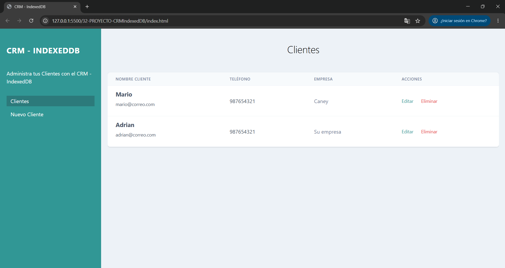

# 👥 CRM - IndexedDB

Aplicación web desarrollada con **HTML5, CSS3 y JavaScript** que permite gestionar información de clientes mediante un sistema CRM (Customer Relationship Management).

El proyecto utiliza **IndexedDB** como mecanismo de almacenamiento local, permitiendo registrar, consultar, editar y eliminar clientes directamente desde el navegador, sin necesidad de un servidor backend.

Este desarrollo forma parte de mi aprendizaje de JavaScript y está enfocado en la práctica de operaciones CRUD, manipulación del DOM, programación asíncrona y almacenamiento de datos en el navegador.

## 🚀 Demo

🔗 [Ver aplicación en GitHub Pages](https://cristhiancyhr.github.io/crm-indexeddb-js/)

## 📸 Vista previa



## ✨ Funcionalidades

- **Registrar clientes:** permite ingresar nombre, correo electrónico, teléfono y empresa.
- **Validar formularios:** comprueba que todos los campos estén completos.
- **Evitar correos duplicados:** utiliza un índice único en IndexedDB para impedir el registro de clientes con el mismo correo electrónico.
- **Visualizar clientes:** muestra los registros almacenados en una tabla.
- **Editar clientes:** permite modificar la información de un cliente existente.
- **Eliminar clientes:** permite eliminar registros previa confirmación del usuario.
- **Almacenamiento persistente:** conserva la información mediante IndexedDB, incluso después de cerrar o recargar la página.
- **Notificaciones dinámicas:** muestra mensajes de éxito y error durante las operaciones.

## 🛠️ Tecnologías utilizadas

- **HTML5:** estructura de las páginas y formularios.
- **CSS3:** presentación visual.
- **Tailwind CSS:** estilos mediante clases utilitarias.
- **JavaScript (ES6+):** lógica de la aplicación y manipulación del DOM.
- **IndexedDB:** almacenamiento de información en el navegador.
- **Git y GitHub:** control de versiones y publicación del proyecto.

## 🧠 Conceptos de JavaScript aplicados

- Manipulación del DOM.
- Gestión de eventos con `addEventListener`.
- Funciones y expresiones funcionales.
- Funciones autoejecutables (IIFE).
- Objetos y desestructuración.
- Operador de propagación y conversión de tipos.
- `URLSearchParams` para obtener parámetros de la URL.
- Temporizadores con `setTimeout`.
- Programación asíncrona mediante eventos.
- Transacciones de lectura y escritura.
- Manejo de errores en operaciones con IndexedDB.
- Operaciones CRUD (Create, Read, Update, Delete).

## 💾 Almacenamiento con IndexedDB

La aplicación utiliza una base de datos denominada `crm`, con un almacén de objetos (*Object Store*) llamado `crm`.

Cada registro contiene:

- ID del cliente.
- Nombre.
- Correo electrónico.
- Teléfono.
- Empresa.

Se implementan índices para facilitar la organización de los datos y establecer restricciones de unicidad en el correo electrónico.

### Operaciones CRUD implementadas

| Operación | Método o mecanismo |
|---|---|
| Create | `objectStore.add()` |
| Read | `objectStore.openCursor()` |
| Update | `objectStore.put()` |
| Delete | `objectStore.delete()` |

## 📂 Estructura del proyecto

```text
crm-indexeddb-js/
├── css/
│   └── tailwind.min.css
├── img/
│   └── preview.png
├── js/
│   ├── app.js
│   ├── editarcliente.js
│   ├── funciones.js
│   └── nuevocliente.js
├── editar-cliente.html
├── index.html
├── nuevo-cliente.html
├── .gitignore
└── README.md
```

## ⚙️ Instalación y ejecución

1. Clona el repositorio:

   ```bash
   git clone https://github.com/cristhianychr/crm-indexeddb-js.git
   ```

2. Accede a la carpeta:

   ```bash
   cd crm-indexeddb-js
   ```

3. Abre `index.html` en tu navegador.

No es necesario instalar dependencias adicionales ni configurar un servidor backend.

## 📌 Aprendizajes

Este proyecto me permitió reforzar el uso de IndexedDB para desarrollar aplicaciones que necesitan almacenar información de manera persistente en el navegador.

También practiqué la implementación de operaciones CRUD, el manejo de transacciones, la validación de formularios y la navegación entre páginas mediante parámetros de URL.

## 👨‍💻 Autor

Proyecto desarrollado como parte de mi formación práctica en JavaScript y desarrollo web.

Cristhian Chanamé
Estudiante de Ingeniería de Software.